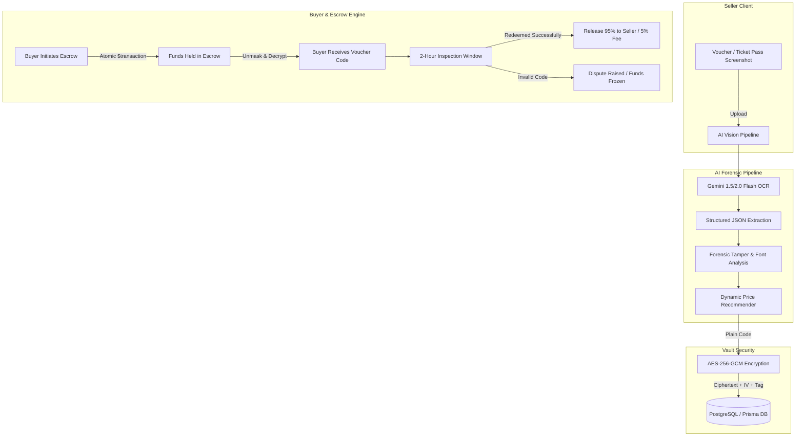

# PerkSwap ⚡
### AI-Powered P2P Voucher & Digital Pass Escrow Marketplace

> **PerkSwap** is a peer-to-peer marketplace where users can trade, swap, or liquidate unused brand coupons, e-gift vouchers, and transferable digital passes before they expire—guaranteed with atomic escrow protection, Google Gemini multimodal fraud forensics, and zero raw code exposure.

---

## 1. System Architecture



---

## 2. Key Modules & Technical Specifications

### A. AI Multimodal Vision Pipeline (`src/services/aiVision.ts`)
- **Multimodal OCR**: Google Gemini API analyzes voucher screenshots to extract brand, category, voucher code, face value, minimum spend, expiry date, and terms.
- **Forensic Tamper Detection**: Evaluates font antialiasing inconsistencies, pixel noise distribution, clone stamp anomalies, and digital overlay masks, outputting a `fraudRiskScore` (0–100) and forensic flags.
- **Dynamic Pricing Engine**: Generates market-optimized discounts (15%–40% off face value) based on expiry urgency and category liquidity.

### B. Two Trading Modes
1. **Cash / Escrow Purchase (`src/services/escrowService.ts`)**:
   - Atomic database transaction (`prisma.$transaction`) locks buyer funds into escrow.
   - Code is decrypted via AES-256 and revealed to the buyer.
   - 2-hour inspection window allows verification on the brand checkout.
   - Upon confirmation, escrow releases funds to seller minus a 5% platform fee.
2. **P2P Voucher Swap (`src/services/swapService.ts`)**:
   - Asset-to-asset direct exchange (e.g., ₹500 Uber ride pass for ₹500 Swiggy dining coupon).
   - Both voucher codes remain locked until mutual acceptance, when both codes are simultaneously decrypted and revealed.

### C. Automated Price Decay Engine (`src/services/decayEngine.ts`)
- Automated background worker discounts perishable listings by a configurable rate (default 5% every 24 hours) to incentivize liquidity before the voucher expires worthless.
- Safety floor prevents decay below 20% of face value.

### D. AI Natural-Language Deal Matcher (`src/services/aiMatcher.ts`)
- Plain English search (e.g. *"I'm buying shoes on Myntra for 2500, find me the best coupon"*).
- Gemini extracts cart amount and brand intent, calculating `Net Cash Profit = Applicable Discount - Voucher Purchase Cost` to guarantee positive return on investment.

### E. Zero Raw Exposure & Cryptographic Security (`src/lib/crypto.ts`)
- Raw voucher codes are **never** returned in public marketplace queries.
- Codes are encrypted at rest using AES-256-GCM with unique initialization vectors (IV) and authentication tags.

---

## 3. Directory Structure

```
PerkSwap/
├── prisma/
│   ├── schema.prisma          # Production PostgreSQL schema with pgvector readiness
│   └── schema.sqlite.prisma   # Zero-config SQLite local development schema
├── scripts/
│   └── seed.mjs               # Seed script with verified demo vouchers and sellers
├── src/
│   ├── app/
│   │   ├── api/
│   │   │   ├── auth/          # Register, Login, Me endpoints (JWT + bcrypt)
│   │   │   ├── coupons/       # AI Deal Matcher (/recommend)
│   │   │   ├── cron/          # Automated Price Decay worker (/price-decay)
│   │   │   ├── escrow/        # Escrow initiate, release, dispute
│   │   │   ├── payments/      # Razorpay Test Mode order, verify, webhook, status
│   │   │   ├── swaps/         # P2P Swap propose, accept, decline
│   │   │   ├── vouchers/      # Scan (AI OCR), Create (AES encryption), Get feed
│   │   │   └── wallet/        # Coin packages catalog (unverified POST topup blocked)
│   │   ├── dashboard/         # User dashboard & transaction center
│   │   ├── escrow/[id]/       # 4-stage interactive Escrow Tracker console
│   │   ├── sell/              # AI Auto-Listing Studio (Drag & drop upload)
│   │   ├── swaps/             # Asset-to-Asset Swap Exchange
│   │   ├── vouchers/[id]/     # Voucher details & forensic report
│   │   ├── layout.tsx         # Root layout with Navbar & Footer
│   │   └── page.tsx           # Homepage & filterable marketplace feed
│   ├── components/
│   │   ├── AiSmartMatcherModal.tsx # Natural-language deal arbitrage
│   │   ├── EscrowTracker.tsx       # Live countdown & release actions
│   │   ├── MarketplaceFeed.tsx     # Filterable feed with decay tags
│   │   ├── Navbar.tsx              # Top bar with escrow wallet chip
│   │   ├── Providers.tsx           # Context & state management
│   │   ├── SmartUploadModal.tsx    # Drag-and-drop OCR & fraud inspection
│   │   ├── SwapProposalModal.tsx   # Asset swap selector
│   │   └── TrustBadge.tsx          # 0-100 Trust Score component
│   ├── lib/
│   │   ├── auth.ts            # JWT signing & password hashing
│   │   ├── crypto.ts          # AES-256-GCM encryption & decryption
│   │   ├── db.ts              # Resilient dual-mode database access
│   │   ├── prisma.ts          # Prisma singleton
│   │   └── validations.ts     # Zod request validation schemas
│   └── services/
│       ├── aiMatcher.ts       # Natural language cart arbitrage
│       ├── aiVision.ts        # Google Gemini Vision OCR & Forensics
│       ├── decayEngine.ts     # 24-hour automated price decay engine
│       ├── escrowService.ts   # Atomic escrow ledger
│       └── swapService.ts     # P2P voucher swap engine
├── .env.example
├── next.config.mjs
├── package.json
├── tailwind.config.js
└── tsconfig.json
```

---

## 4. Setup & Running Locally

### Prerequisites
- Node.js 18+ (tested on v22.15.0)
- Optional: PostgreSQL connection string or SQLite local mode

### 1. Environment Configuration
Copy `.env.example` to `.env`:
```bash
cp .env.example .env
```
Add your Google Gemini API key:
```env
GEMINI_API_KEY="AIzaSy..."
```

### 2. Install Dependencies
```bash
npm install
```

### 3. Generate Prisma Client
```bash
npx prisma generate
```

### 4. Run Development Server
```bash
npm run dev
```
Open [http://localhost:3000](http://localhost:3000) to access the PerkSwap application.

---

## 5. Razorpay Payment Gateway Integration (TEST MODE ONLY)

PerkSwap uses **Razorpay Standard Checkout exclusively in Test Mode (`rzp_test_*`)** for purchasing PerkSwap Coin packages. Direct voucher-for-voucher swaps remain completely **free (0 coins)**, and arbitrary/unverified wallet top-ups (`POST /api/wallet/topup`) are disabled (`403`).

### Coin Packages (Server-Authoritative Pricing)
| Package ID | Coins | Bonus Coins | Total Coins | Price (INR) |
| --- | ---: | ---: | ---: | ---: |
| `pkg_100` | 100 | 0 | 100 | ₹49 (`4900` paise) |
| `pkg_250` | 250 | 0 | 250 | ₹99 (`9900` paise) |
| `pkg_500` | 500 | +25 | 525 | ₹179 (`17900` paise) |
| `pkg_1000` | 1000 | +100 | 1100 | ₹349 (`34900` paise) |

> **Important:** The frontend only sends `packageId`. Payable amount, currency (`INR`), and coin totals are calculated strictly on the server from [`COIN_PACKAGES`](src/lib/constants.ts).

### Required Environment Variables
Configure these backend environment variables in `.env` (never commit `.env` to Git):

```env
RAZORPAY_KEY_ID="rzp_test_your_test_key_id_here"
RAZORPAY_KEY_SECRET="your_razorpay_test_key_secret_here"
RAZORPAY_WEBHOOK_SECRET="your_razorpay_test_webhook_secret_here"
```

- **Strict Test Mode Guard:** [`src/lib/razorpay.ts`](src/lib/razorpay.ts) and [`src/instrumentation.ts`](src/instrumentation.ts) validate keys on startup and on every payment request. Any Live key (`rzp_live_*`) is immediately rejected.
- `RAZORPAY_KEY_SECRET` and `RAZORPAY_WEBHOOK_SECRET` stay strictly server-side and are never returned to client components or logs.

### Razorpay Test Account & Dashboard Setup Guide
1. Sign up or log in at the [Razorpay Dashboard](https://dashboard.razorpay.com/).
2. Ensure the top toggle is switched to **Test Mode** (do **not** activate or use Live Mode keys).
3. Go to **Account & Settings → API Keys → Generate Test Key** to download your `Key Id` (`rzp_test_...`) and `Key Secret`.
4. Add `RAZORPAY_KEY_ID` and `RAZORPAY_KEY_SECRET` to your local `.env` file.
5. (For Webhooks) Go to **Account & Settings → Webhooks → + Add New Webhook** (in **Test Mode**):
   - Set **Webhook URL** to your publicly reachable tunnel + `/api/payments/webhook` (e.g., via `ngrok http 3000` → `https://<your-ngrok-domain>/api/payments/webhook`).
   - Choose a **Secret** and copy it to `RAZORPAY_WEBHOOK_SECRET` in `.env`.
   - Enable events: `payment.captured`, `payment.failed`, `order.paid`.

### Payment API Route Handlers
- `POST /api/payments/create-order` — Requires JWT auth; validates `{ packageId }` strictly (rejecting client-supplied amounts); creates an INR order in Razorpay Test Mode; stores a `Payment` record (`status: "created"`); returns `orderId`, `amount`, `currency`, `keyId`, and package summary.
- `POST /api/payments/verify` — Requires JWT auth + order ownership; verifies HMAC-SHA256 signature (`order_id + "|" + payment_id`) using `crypto.timingSafeEqual`; fetches authoritative payment details via `razorpay.payments.fetch()`; validates order/amount/currency match and `status === "captured"` + `captured === true`; atomically credits coins once and writes a `PACKAGE_PURCHASE` `WalletLedger` entry. Returns `202` for authorized/uncaptured payments without crediting coins.
- `POST /api/payments/webhook` — Reads unmodified raw body (`await req.text()`) before JSON parsing; verifies `X-Razorpay-Signature` via `crypto.timingSafeEqual`; handles `payment.captured`, `order.paid`, and `payment.failed` idempotently (tracks `processedWebhookEvents` and refuses to overwrite an already-captured order).
- `GET /api/payments/status/:orderId` — Requires JWT auth + order ownership; returns sanitized order/payment state and current `walletBalance`.

### Testing Checkout, Failures & Webhooks Locally
1. Restart your dev server after updating `.env` (`npm run dev`).
2. Log in, click **+ Add** in the Navbar (or **Buy Coins** on Dashboard / Profile → Wallet & Payments), and select a coin package.
3. **Simulate Success:** In Razorpay Test Checkout, choose **Card** or **UPI** → **Success** (or Razorpay's published test card / UPI ID `success@razorpay`). Watch `/api/payments/verify` confirm capture and update your wallet & Wallet Ledger.
4. **Simulate Failure:** In Razorpay Test Checkout, trigger **Failure** (e.g. `failure@razorpay` or card failure simulation). The UI displays the failed payment banner and **0 coins** are credited.
5. **Test Webhook Delivery Locally:** Run `ngrok http 3000`, register `https://<ngrok-host>/api/payments/webhook` in Razorpay Dashboard (Test Mode), and trigger a checkout flow or replay an event from **Test Mode → Webhooks → Event Logs**.

### Security Controls Implemented
- Strict `rzp_test_` validation on startup and runtime (live keys blocked).
- Constant-time HMAC-SHA256 verification (`crypto.timingSafeEqual`) for both Checkout callback signatures and raw-body webhooks.
- Authoritative server-side Gateway fetch (`payments.fetch`) confirming `status === "captured"` and exact `amount` / `currency` / `order_id`.
- Atomic MongoDB transaction (`session.withTransaction` with single-document conditional fallback on standalone MongoDB) preventing double-crediting under concurrent `/verify` and webhook deliveries.
- Endpoint rate limiting, strict Zod schemas, cross-user ownership enforcement (`403`), and disabled client-side balance top-ups.
# PerkSwap

